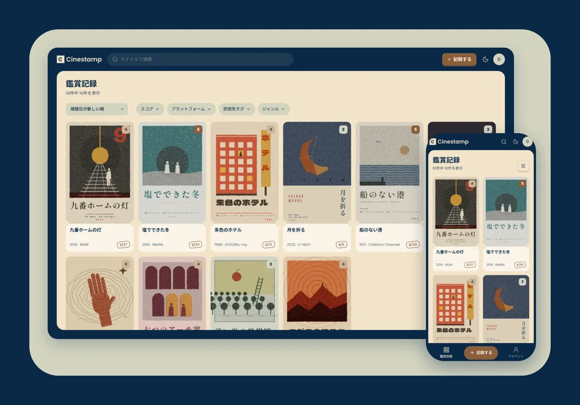
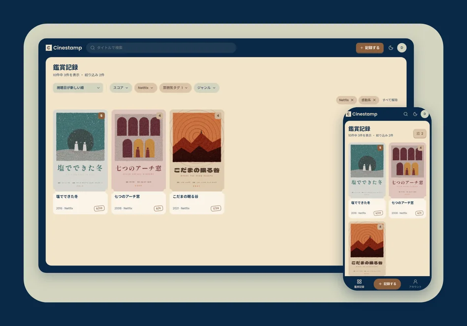
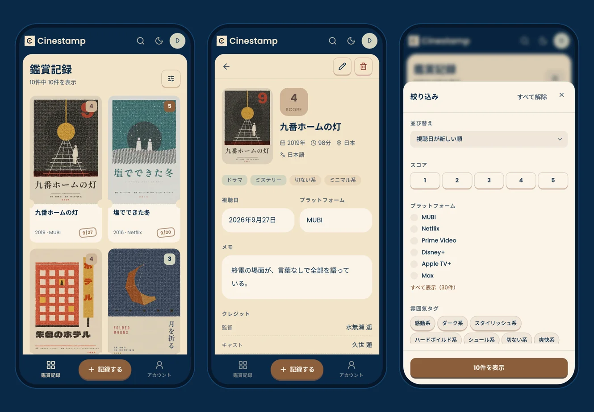
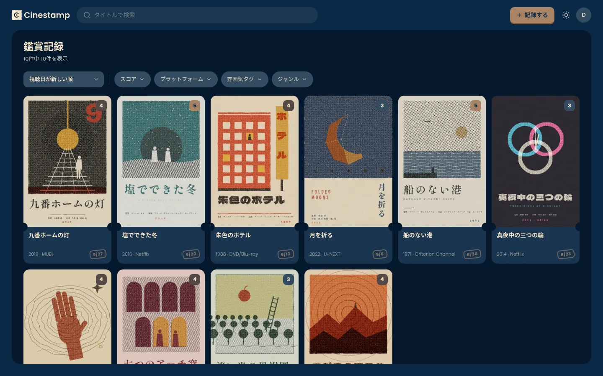
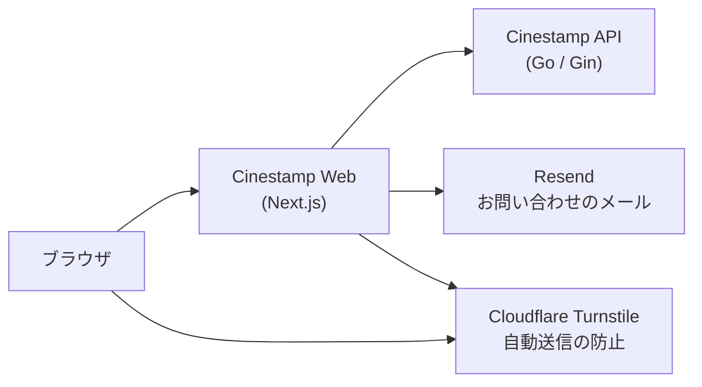

<div align="center">

# Cinestamp

[English](README.md) | **日本語**

映画鑑賞記録アプリ「Cinestamp」の Web アプリです。<br/>観た映画ごとに、ポスター、鑑賞日、スコア、気分、メモを記録できます。




</div>

本リポジトリでは、Cinestamp の Web アプリを管理しています。データの取得と保存には [Cinestamp API](https://github.com/masaya-nishimura-09/movie-log-api) を利用し、モックデータを使えば API なしでも動作します。[モバイルアプリ](https://github.com/masaya-nishimura-09/movie-log-mobile)もあります。

## 概要

記録にはプラットフォームと気分が残るため、観た映画をこれらの条件で絞り込めます。「Netflix で観られる、感動する映画はない？」と聞かれたときも、すぐに答えを見つけられます。

<p align="center">
  
</p>

<p align="center">
  
</p>

<p align="center">
  
</p>

## アーキテクチャ



ブラウザから API へは直接アクセスしません。Server Components と Server Actions がサーバー側で API を呼び出し、アクセストークンとリフレッシュトークンは HTTP-only の Cookie に保存します。言語の振り分け、ログイン画面へのリダイレクト、トークンの更新は `src/proxy.ts` が担います。

UI コンポーネントは、atoms、molecules、organisms の 3 層に分けています。

## 主な機能

**鑑賞記録**

- 鑑賞記録の作成・表示・更新・削除
- TMDB を利用した映画情報（公開年、上映時間、言語、制作国、ジャンル、クレジット、ポスター）の入力
- ポスター画像のアップロード
- カレンダーによる鑑賞日の選択（「今日」「昨日」の入力にも対応）

**記録の検索**

- タイトル検索、並べ替え、ページネーション
- スコア、プラットフォーム、気分、ジャンルによる絞り込み（スコアとプラットフォームは 1 つ、気分とジャンルは指定したすべてを含む記録のみ）

**記事**

- 鑑賞記録ごとの記事の作成・表示・更新・削除
- 太字、斜体、見出し、小見出し、箇条書き、番号付きリスト、引用を使える本文のエディタ
- 見出しから作る目次（読んでいる位置の見出しを強調）
- タイトルと本文のキーワード検索、記録による絞り込み、並べ替え、ページネーション

**アカウント**

- ユーザー登録、ログイン、ログアウト（トークンは自動で更新）
- アカウント情報の変更と退会
- Cloudflare Turnstile による、ログインとユーザー登録の自動送信の防止

**お問い合わせ**

- Resend を利用した、メールで届くお問い合わせフォーム
- Cloudflare Turnstile と非表示の入力欄による、自動送信の防止

**画面**

- 日本語と英語（ブラウザの言語設定から自動で選択）
- ライトテーマとダークテーマ
- スマホと PC の両方に対応したレイアウト
- リンクを共有したときのプレビューカード（Open Graph）

**セキュリティと運用**

- Content-Security-Policy をはじめとするセキュリティヘッダーの付与
- 利用者単位のレート制限のための、クライアント IP と内部シークレットの API への送信
- サーバーのエラーと警告の構造化ログ（JSON）
- API なしで動作するモックモード

## デザイン

画面は 4 色で構成しています。赤は、エラーと削除にのみ使用します。


ほかの色は、すべて `src/styles/globals.css` でこの 4 色を混ぜて作っています。文字の太さは役割で使い分けており、本文は 400、押せる要素は 500、見出し・主要なボタン・スコアは 700 です。

## 技術スタック

| 分類           | 使用技術                                             |
|----------------|------------------------------------------------------|
| フレームワーク | Next.js（App Router）、React                         |
| 言語           | TypeScript                                           |
| スタイル       | Tailwind CSS、shadcn/ui（Base UI）、react-day-picker |
| エディタ       | Tiptap                                               |
| バリデーション | Zod                                                  |
| テスト         | Vitest、Cypress                                      |
| ボット対策     | Cloudflare Turnstile                                 |
| お問い合わせ   | Resend                                               |
| 開発ツール     | Biome、pnpm                                          |

## セットアップ

### 前提条件

- Node.js 20.9 以上
- pnpm
- [Cinestamp API](https://github.com/masaya-nishimura-09/movie-log-api)（モックモードでは不要）

### インストール

```bash
git clone https://github.com/masaya-nishimura-09/movie-log.git
cd movie-log
pnpm install
cp .env.example .env.local
# .env.local を編集し、各環境変数を設定する
pnpm dev
```

アプリは `http://localhost:3000` で起動します。

### モックモード

`USE_MOCK=true` を設定すると、API を使わずにモックデータで動作します。メールアドレス `demo@example.com`、パスワード `password` でログインできます。モックデータはメモリ上に保持され、サーバーを再起動すると初期状態に戻ります。記録はアカウントごとに分かれていて、初期データの記録はデモ用のアカウントのものです。新しく登録したアカウントは、記録が 0 件の状態から始まります。エラーの表示を確かめるため、次の値で失敗を返します。タイトル検索に `__error__` と入れると、記録の一覧が 500 を返します。送信する項目のどれかが `__error__` なら 500、`__too_many__` なら 429 を返します（例：ログインのパスワード、記録のタイトル）。表示名が `__withdraw_error__` のアカウントは、退会が 500 で失敗します。メモが `__delete_error__` の記録は、削除が 500 で失敗します。

### 環境変数

`.env.local` に次の環境変数を設定してください。

| 変数                   | 必須/任意 | 説明                                                                 |
|------------------------|-----------|----------------------------------------------------------------------|
| `API_BASE_URL`         | 必須      | Cinestamp API のベース URL（モックモードでは不要）                     |
| `USE_MOCK`             | 任意      | `true` にすると、API の代わりにモックデータを使用                    |
| `MOCK_DATASET`         | 任意      | `demo` にすると、モックモードで架空のデモ映画を使用                  |
| `MOCK_LANGUAGE`        | 任意      | `en` にすると、英語のモックデータを使用（それ以外は日本語）          |
| `INTERNAL_API_SECRET`  | 任意      | API との共有シークレット。クライアント IP 単位のレート制限に使用（API と同じ値を設定） |
| `APP_VERSION`          | 任意      | ログに記録するバージョン（Git のコミット ID など）                   |
| `RESEND_API_KEY`       | 任意      | Resend の API キー（お問い合わせフォームを使う場合は必須）           |
| `CONTACT_TO_EMAIL`     | 任意      | お問い合わせを受け取るメールアドレス（お問い合わせフォームを使う場合は必須） |
| `CONTACT_FROM_EMAIL`   | 任意      | お問い合わせのメールの送信元（既定値 `Cinestamp <onboarding@resend.dev>`） |
| `TURNSTILE_SITE_KEY`   | 必須      | Cloudflare Turnstile のサイトキー（モックモードでは不要）            |
| `TURNSTILE_SECRET_KEY` | 必須      | Cloudflare Turnstile の秘密鍵（モックモードでは不要）                |

### スクリプト

| コマンド            | 説明                                    |
|---------------------|-----------------------------------------|
| `pnpm dev`          | 開発サーバーの起動                      |
| `pnpm build`        | 本番用のビルド                          |
| `pnpm start`        | ビルドしたアプリの起動                  |
| `pnpm lint`         | Biome によるチェック                    |
| `pnpm fix`          | lint の指摘の自動修正                   |
| `pnpm format`       | Biome による整形                        |
| `pnpm typecheck`    | TypeScript の型チェック                 |
| `pnpm test`         | Vitest によるテストの実行               |
| `pnpm test:watch`   | ファイルの変更を監視してテストを実行    |
| `pnpm test:e2e`     | Cypress による E2E テストの実行         |
| `pnpm cypress:open` | Cypress の画面を開いて E2E テストを実行 |

単体テストは、対象のファイルの隣に `*.test.ts` として置いています（例：`src/lib/url/build-href.test.ts`）。

E2E テストは `cypress/e2e/` に、画面ごとのフォルダに分けて置いています。`pnpm test:e2e` は、本番用にビルドしたアプリをモックモードでポート 3300 に起動し、Chrome で実行します（Chrome のインストールが必要）。

## ディレクトリ構成

```
src/
  app/                # ルーティング（[lang]/(app)、(auth)、(legal)）
  actions/            # Server Actions
  api/                # API クライアント、モックデータ
  components/         # UI コンポーネント（atoms、molecules、organisms）
  hooks/              # React のカスタムフック
  schemas/            # Zod スキーマ
  i18n/               # 言語設定、辞書
  lib/                # 補助関数（article、auth、contact、date、log、navigation、record、style、text、turnstile、url）
  styles/             # グローバルスタイル、色の定義
  proxy.ts            # 言語の振り分け、トークンの更新
  instrumentation.ts  # 未処理のサーバーエラーのログ出力
```

## ページ

| パス                                        | 内容                 | ログイン |
|---------------------------------------------|----------------------|----------|
| /:lang                                      | ランディングページ   | 不要     |
| /:lang/login                                | ログイン             | 不要     |
| /:lang/register                             | ユーザー登録         | 不要     |
| /:lang/about                                | このアプリについて   | 不要     |
| /:lang/contact                              | お問い合わせ         | 不要     |
| /:lang/terms                                | 利用規約             | 不要     |
| /:lang/privacy                              | プライバシーポリシー | 不要     |
| /:lang/records                              | 鑑賞記録の一覧       | 必要     |
| /:lang/records/new                          | 鑑賞記録の作成       | 必要     |
| /:lang/records/:id                          | 鑑賞記録の詳細       | 必要     |
| /:lang/records/:id/edit                     | 鑑賞記録の編集       | 必要     |
| /:lang/records/:id/articles/new             | 記事の作成           | 必要     |
| /:lang/records/:id/articles/:articleId      | 記事の詳細           | 必要     |
| /:lang/records/:id/articles/:articleId/edit | 記事の編集           | 必要     |
| /:lang/articles                             | 記事の一覧           | 必要     |
| /:lang/account                              | アカウント設定       | 必要     |

## クレジット

本アプリケーションは TMDB および TMDB API を使用していますが、TMDB による推奨、認定、その他の承認を受けたものではありません。
