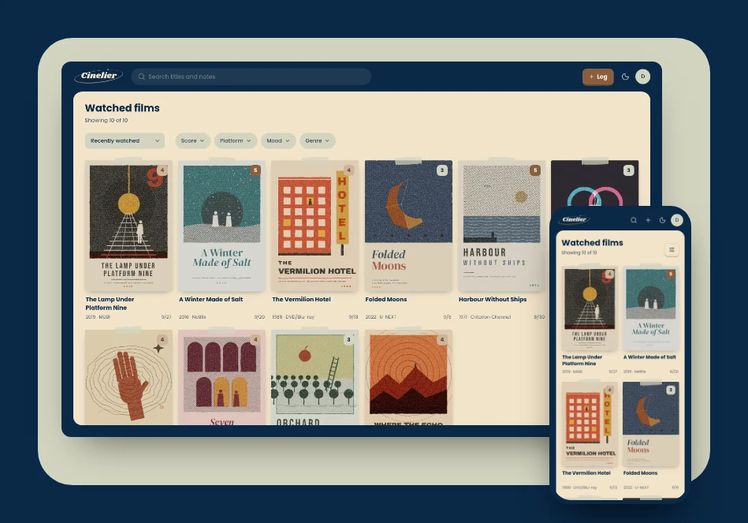
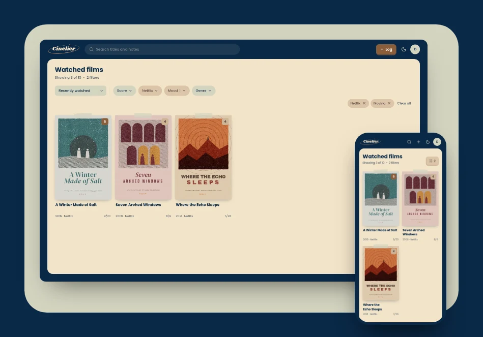
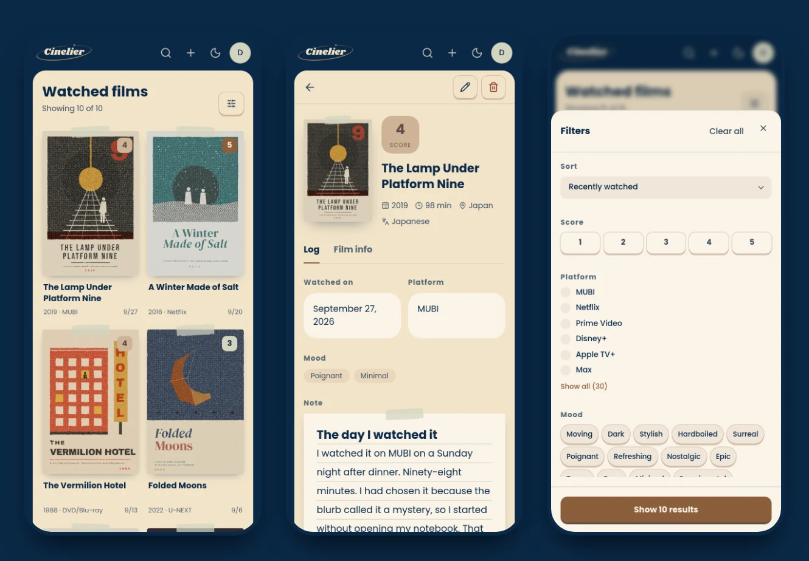
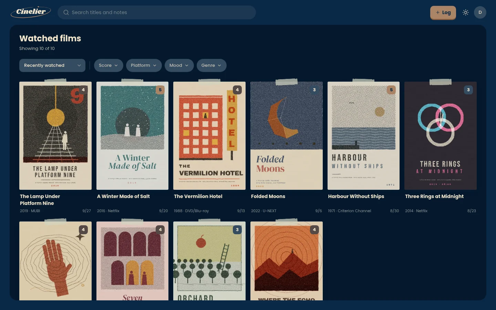
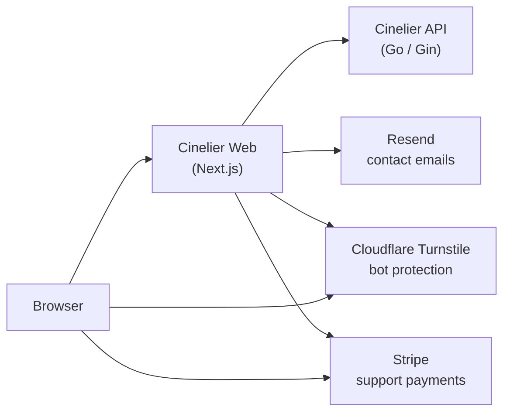

<div align="center">

# Cinelier

**English** | [日本語](README.ja.md)

The web app of Cinelier,
an app for keeping a record of the films you watch.\
Each record keeps the poster, viewing date, score, mood, and notes for a film.




</div>

This repository contains the web app of Cinelier. It uses the
[Cinelier API](https://github.com/masaya-nishimura-09/movie-log-api)
for data and can also run on its own with mock data.
A [mobile app](https://github.com/masaya-nishimura-09/movie-log-mobile)
is also available.

## Overview

Since every record includes the platform and mood, you can filter the films
you have watched by those conditions. When someone asks
"Is there anything moving on Netflix?", you can find an answer right away.







## Architecture



The browser never calls the API directly. Server Components and
Server Actions call the API on the server, and the access and refresh tokens
are kept in HTTP-only cookies. `src/proxy.ts` handles language routing,
redirects to the login page, and token refresh.

UI components are organized into atoms, molecules, and organisms.

## Features

### Viewing Records

- Create, view, update, and delete viewing records
- Film details (original title, synopsis, release year, runtime, language,
  countries, genres, credits, and poster) filled in from TMDB
- Poster image uploads
- Viewing date selection from a calendar, with shortcuts for today and yesterday
- Up to 10 attached images per record, such as pamphlets, flyers, or drawings,
  added when creating a record or later, and viewed one by one
  with previous and next buttons
- One note per record, written in an editor with bold, italic, headings,
  subheadings, bulleted lists, numbered lists, and quotes
- A record page split into a log tab (mood, note, and attachments)
  and a film info tab (original title, synopsis, genres, and credits)

### Finding Records

- Search over titles and notes, sorting, and pagination
- Filtering by score, platform, mood, and genre
  (one score and one platform;
  moods and genres match only records that have all of them)

### Accounts

- Registration, login, and logout, with automatic token refresh
- Account updates and deletion
- Export of the film log as a CSV file and of the notes as Markdown files
  in a ZIP
- Protection against automated login and registration with Cloudflare Turnstile

### Contact

- A contact form that sends messages by email through Resend
- Protection against automated submissions with Cloudflare Turnstile
  and a hidden field

### Support

- Support payments to the developer through Stripe Checkout
  (¥300, ¥500, ¥1,000, or a custom amount from ¥100 to ¥10,000)
- A thanks page shown only after Stripe confirms the payment

### Interface

- Japanese and English, chosen from the browser language
- Light and dark themes
- Layouts for phones and desktops
- Preview cards for shared links (Open Graph)

### Security and Operations

- Security headers on every response, including Content-Security-Policy
- The client IP and an internal secret sent to the API
  so it can rate limit per visitor
- Structured JSON logs for server errors and warnings
- A mock mode that runs without the API

## Design

The interface is built from four colors,
with red reserved for errors and deletion.


All other colors are mixed from these four in `src/styles/globals.css`.
Font weights depend on the role of the text: 400 for body text,
500 for anything that can be pressed,
and 700 for headings, primary buttons, and scores.

## Tech Stack

| Category       | Technologies                                        |
|----------------|-----------------------------------------------------|
| Framework      | Next.js (App Router), React                         |
| Language       | TypeScript                                          |
| Styling        | Tailwind CSS, shadcn/ui (Base UI), react-day-picker |
| Editor         | Tiptap                                              |
| Validation     | Zod                                                 |
| Testing        | Vitest, Cypress                                     |
| Bot protection | Cloudflare Turnstile                                |
| Contact        | Resend                                              |
| Payments       | Stripe                                              |
| Tooling        | Biome, pnpm                                         |

## Setup

### Prerequisites

- Node.js 20.9 or later
- pnpm
- [Cinelier API](https://github.com/masaya-nishimura-09/movie-log-api)
  (not required in mock mode)

### Installation

```bash
git clone https://github.com/masaya-nishimura-09/movie-log.git
cd movie-log
pnpm install
cp .env.example .env.local
# Edit .env.local and set each environment variable
pnpm dev
```

The app starts on `http://localhost:3000`.

### Mock Mode

When `USE_MOCK=true`, the app runs on mock data without the API.
Log in with `demo@example.com` and the password `password`.
Mock data is kept in memory and resets when the server restarts.
Records belong to each account, and the initial records belong to
the demo account, so a newly registered account starts with no records.

To check how errors are shown, some values make the mock fail.
Searching for the title `__error__` makes the record list return 500.
If any submitted field is `__error__`, the request returns 500,
and if it is `__too_many__`, it returns 429
(for example, the login password or a record title).
An account whose display name is `__withdraw_error__` fails to withdraw
with 500, and a record titled `__delete_error__` fails to delete
with 500.

### Environment Variables

Set the following environment variables in `.env.local`.

| Variable               | Required | Description                                                         |
|------------------------|----------|---------------------------------------------------------------------|
| `API_BASE_URL`         | Required | Base URL of the Cinelier API (not required in mock mode)             |
| `SITE_URL`             | Optional | Public URL of the site, used for the sitemap, OGP and Stripe return URLs (default: `http://localhost:3000`) |
| `USE_MOCK`             | Optional | Set to `true` to use mock data instead of the API                   |
| `MOCK_DATASET`         | Optional | Set to `demo` to use the fictional demo films in mock mode          |
| `MOCK_LANGUAGE`        | Optional | Set to `en` for English mock records (Japanese otherwise)           |
| `INTERNAL_API_SECRET`  | Optional | Secret shared with the API for rate limiting by client IP (must match the API's value) |
| `APP_VERSION`          | Optional | Version written to logs, such as the Git commit hash                |
| `RESEND_API_KEY`       | Optional | Resend API key (required for the contact form)                      |
| `CONTACT_TO_EMAIL`     | Optional | Address that receives contact messages (required for the contact form) |
| `CONTACT_FROM_EMAIL`   | Optional | Sender of contact emails (default: `Cinelier <onboarding@resend.dev>`) |
| `TURNSTILE_SITE_KEY`   | Required | Cloudflare Turnstile site key (not required in mock mode)           |
| `TURNSTILE_SECRET_KEY` | Required | Cloudflare Turnstile secret key (not required in mock mode)         |
| `STRIPE_SECRET_KEY`    | Optional | Stripe secret key (required for support payments)                   |

### Scripts

| Command             | Description                                  |
|---------------------|----------------------------------------------|
| `pnpm dev`          | Start the development server                 |
| `pnpm build`        | Build for production                         |
| `pnpm start`        | Start the production build                   |
| `pnpm lint`         | Check the code with Biome                    |
| `pnpm fix`          | Fix lint issues                              |
| `pnpm format`       | Format the code with Biome                   |
| `pnpm typecheck`    | Run the TypeScript type check                |
| `pnpm test`         | Run the tests with Vitest                    |
| `pnpm test:watch`   | Run the tests and rerun them on file changes |
| `pnpm test:e2e`     | Run the end-to-end tests with Cypress        |
| `pnpm cypress:open` | Open Cypress and run the end-to-end tests    |

Unit tests sit next to the file they test as `*.test.ts`
(for example, `src/lib/url/build-href.test.ts`).

End-to-end tests live in `cypress/e2e/`, in one folder per screen.
`pnpm test:e2e` builds the app for production, starts it in mock mode
on port 3300, and runs the tests in Chrome (Chrome must be installed).

## Project Structure

```text
src/
  app/                # Routes ([lang]/(app), (auth), (legal))
  actions/            # Server Actions
  api/                # API clients and mock data
  components/         # UI components (atoms, molecules, organisms)
  hooks/              # Custom React hooks
  schemas/            # Zod schemas
  i18n/               # Locales and dictionaries
  lib/                # Helpers grouped by feature (note, record, url, ...)
  styles/             # Global styles and color tokens
  proxy.ts            # Language routing and token refresh
  instrumentation.ts  # Logging of unhandled server errors
```

## Pages

| Path                                        | Description               | Login        |
|---------------------------------------------|---------------------------|--------------|
| /:lang                                      | Landing page              | Not required |
| /:lang/login                                | Login                     | Not required |
| /:lang/register                             | Registration              | Not required |
| /:lang/about                                | About the app             | Not required |
| /:lang/contact                              | Contact form              | Not required |
| /:lang/terms                                | Terms of use              | Not required |
| /:lang/privacy                              | Privacy policy            | Not required |
| /:lang/commerce                             | Commercial disclosure     | Not required |
| /:lang/records                              | Record list               | Required     |
| /:lang/records/new                          | New record                | Required     |
| /:lang/records/:id                          | Record details            | Required     |
| /:lang/records/:id/edit                     | Record editing            | Required     |
| /:lang/account                              | Account settings          | Required     |
| /:lang/support                              | Choosing a support amount | Required     |
| /:lang/support/thanks                       | Thanks for your support   | Required     |

## Credits

This application uses TMDB and the TMDB APIs but is not endorsed,
certified, or otherwise approved by TMDB.
